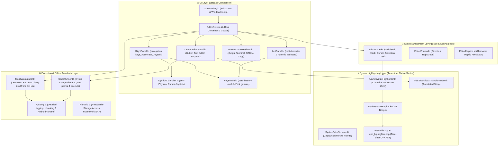

---

# 📖 C/C++ MOBILE IDE PROJECT STRUCTURE DOCUMENTATION (Pudding)

The **Pudding** project is a comprehensive, standalone (offline) C/C++ Integrated Development Environment (IDE) running directly on the Android operating system. The application is uniquely optimized for Landscape Mode with a **GNOME Adwaita Dark / Catppuccin Mocha** visual design, featuring an ergonomic split keyboard, a smooth physical joystick for precision cursor navigation, a Tree-sitter C++ AST parser via C++ Native (JNI), and an on-device Clang/LLVM compiler toolchain.

---

## 🏛️ 1. OVERALL SYSTEM ARCHITECTURE

The system is built on a strict, reactive Unidirectional Data Flow pattern:



---

## 📁 2. DETAILED DIRECTORY TREE

```text
my_text_editor/
├── .gitignore                          # Git ignore configuration for build artifacts, cache, keys
├── build.gradle.kts                    # Root project Gradle build configuration
├── settings.gradle.kts                 # Plugin repositories and module configuration
├── gradle.properties                   # JVM memory settings for Gradle daemon
├── gradlew / gradlew.bat               # Gradle wrapper executables
├── local.properties                    # Local Android SDK path
├── README.md                           # Project overview
├── PROJECT_STRUCTURE.md                # [This document] Complete architecture details
├── gradle/
│   └── wrapper/
│       ├── gradle-wrapper.jar
│       └── gradle-wrapper.properties
└── app/
    ├── build.gradle.kts                # App module build config, CMake NDK, Compose, Dependencies
    └── src/
        └── main/
            ├── AndroidManifest.xml     # Permissions, landscape orientation, main activity declaration
            ├── cpp/                    # NATIVE C/C++ CORE LAYER (Tree-sitter)
            │   ├── CMakeLists.txt      # Build script for native syntax_engine library
            │   ├── native-lib.cpp      # JNI bridge between Kotlin and C++
            │   ├── cpp_highlighter.hpp # Header defining Tree-sitter highlighter
            │   ├── cpp_highlighter.cpp # AST parsing logic, Catppuccin color token mapping
            │   ├── tree-sitter/        # Tree-sitter core C source code
            │   └── tree-sitter-cpp/    # Tree-sitter grammar/parser for C++
            ├── java/com/example/mytexteditor/
            │   ├── MainActivity.kt     # Main Activity, Fullscreen & Window Insets configuration
            │   ├── model/
            │   │   └── EditorEnums.kt  # Enums: RightMode (TYPING, JOYSTICK), Direction
            │   ├── state/
            │   │   └── EditorState.kt  # Manages text state, cursor, Undo/Redo, shortcuts
            │   ├── data/
            │   │   ├── AppLog.kt       # Central logger, prevents log truncation, supports AndroidRuntime
            │   │   ├── CodeRunner.kt   # Offline clang++ compilation, links libffi/zstd, executes binary
            │   │   ├── FileUtils.kt    # File read/write utilities via Storage Access Framework (SAF)
            │   │   └── ToolchainInstaller.kt # Auto-downloads & decompresses Clang Compiler via Zstd
            │   ├── syntax/
            │   │   ├── AsyncSyntaxHighlighter.kt       # Background coroutine debouncing for NativeEngine calls
            │   │   ├── NativeSyntaxEngine.kt           # Loads syntax_engine library & JNI extern declarations
            │   │   ├── SyntaxColorScheme.kt            # Catppuccin Mocha color palette (Mauve, Peach...)
            │   │   └── TreeSitterVisualTransformation.kt# Transforms tokens into Compose AnnotatedString
            │   └── ui/
            │       ├── theme/
            │       │   └── Color.kt                    # GNOME Adwaita Dark UI color palette
            │       ├── components/
            │       │   ├── EditorHaptics.kt            # Haptic feedback utilities
            │       │   ├── EditorIcons.kt              # Vector icons drawn purely with Canvas
            │       │   ├── GnomeConsoleSheet.kt        # GNOME-styled terminal sheet for outputs & STDIN
            │       │   ├── JoystickController.kt       # Simulated 360° cursor navigation joystick
            │       │   └── KeyButton.kt                # Zero-latency touch keyboard button with Flick support
            │       └── editor/
            │           ├── CenterEditorPanel.kt        # Main editor panel, line number gutter, HeaderBar
            │           ├── LeftPanel.kt                # Left keyboard (letters, numbers, symbols, CTRL)
            │           ├── RightPanel.kt               # Right keyboard / Joystick controller / Action Bar
            │           └── EditorScreen.kt             # Main screen assembling the 3 panels, popup overlays
            └── res/
                └── drawable/                           # XML & Vector icon resources
```

---

## 🔍 3. CODEBASE FILE BREAKDOWN

### 3.1. Root Configuration
* **[`build.gradle.kts`](file:///home/quochao/Downloads/my_text_editor/build.gradle.kts)**: Top-level build configuration, loads Android Application Plugin (`8.2.0`) and Kotlin Android Plugin (`1.9.20`).
* **[`settings.gradle.kts`](file:///home/quochao/Downloads/my_text_editor/settings.gradle.kts)**: Declares repository resolution configuration (`google`, `mavenCentral`) and includes the main `:app` module.
* **[`gradle.properties`](file:///home/quochao/Downloads/my_text_editor/gradle.properties)**: JVM memory allocation for Gradle Daemon (`org.gradle.jvmargs=-Xmx2048m -Dfile.encoding=UTF-8`), enables AndroidX and Jetifier.
* **[`.gitignore`](file:///home/quochao/Downloads/my_text_editor/.gitignore)**: Excludes build artifacts, cache `.gradle/`, `.cxx/`, compiled binaries `*.apk`, `*.aab`, compiler temporary files `solution.out`, `solution.cpp`, compressed archives `*.tar.zst`, and local machine configuration `local.properties`.

---

### 3.2. Application Module (`app/`)
* **[`app/build.gradle.kts`](file:///home/quochao/Downloads/my_text_editor/app/build.gradle.kts)**:
  - `namespace`: `com.example.mytexteditor`.
  - `compileSdk`: 34, `minSdk`: 26 (Android 8.0 Oreo), `targetSdk`: 28 (Preserves binary execution privileges inside the app directory).
  - `ndk.abiFilters`: Supports device architectures `arm64-v8a`, `armeabi-v7a`, `x86_64`.
  - `externalNativeBuild.cmake`: Integrates CMake version `3.22.1` to build `src/main/cpp/CMakeLists.txt`.
  - `dependencies`:
    - OkHttp `4.12.0`: Downloads toolchain with redirect and SSL support.
    - Apache Commons Compress `1.26.1`: Extracts Tar streams.
    - Zstandard JNI `1.5.5-11@aar`: Decompresses ultra-fast Zstandard (.zst) Clang packages.
    - Jetpack Compose BOM `2024.01.00`: Modern UI framework components.
* **[`app/src/main/AndroidManifest.xml`](file:///home/quochao/Downloads/my_text_editor/app/src/main/AndroidManifest.xml)**:
  - Declares essential permissions: `INTERNET` (downloads Clang toolchain), `POST_NOTIFICATIONS` (shows download progress in notification tray), `VIBRATE` (key press tactile feedback).
  - Forces `screenOrientation="userLandscape"` (landscape orientation lock) and `windowSoftInputMode="stateAlwaysHidden|adjustNothing"` (suppresses default system keyboard in favor of the custom IDE split keyboard).

---

### 3.3. Startup & Screen Management (`MainActivity` & `EditorScreen`)
* **[`MainActivity.kt`](file:///home/quochao/Downloads/my_text_editor/app/src/main/java/com/example/mytexteditor/MainActivity.kt)**:
  - Initializes `filesDir` and `cacheDir` paths for `CodeRunner`.
  - Configures borderless fullscreen mode using `WindowInsetsControllerCompat`, completely hiding system bars (Navigation & Status bars) to maximize coding real estate.
  - Launches Compose entry point `EditorScreen`.
* **[`EditorScreen.kt`](file:///home/quochao/Downloads/my_text_editor/app/src/main/java/com/example/mytexteditor/ui/editor/EditorScreen.kt)**:
  - Acts as the Root Layout Container.
  - Arranged according to the GNOME 3-column Split Container ratio: `LeftPanel` (27%) | `CenterEditorPanel` (46%, or 100% when Zen Mode is enabled) | `RightPanel` (27%).
  - Observes and manages the Clang Toolchain installation lifecycle: Displays a frosted glass progress modal with percentage updates and a **"Retry"** button on network failure.
  - Manages file pickers (`OpenDocument`), file savers (`CreateDocument`), and confirmation dialogs for unsaved changes.

---

### 3.4. UI Components & Panels
* **[`LeftPanel.kt`](file:///home/quochao/Downloads/my_text_editor/app/src/main/java/com/example/mytexteditor/ui/editor/LeftPanel.kt)**:
  - Left keyboard column divided into 4 fixed rows (Zero Latency Grid).
  - Supports alphabet keys `q, w, e, r, t`, `a, s, d, f, g`, `z, x, c, v`.
  - Implements **Flick Gestures**: flicking upward on a key enters alternate numbers or symbols (e.g., flick `q` for `1`, flick `a` for `~`).
  - Houses modifier and functional keys: `SHIFT` (also activates Text Selection mode), `CTRL` (latch modifier for Ctrl+C, Ctrl+V, Ctrl+Z...), `TAB` (inserts 4 spaces), and `?123` / `ABC` symbol toggles.
* **[`RightPanel.kt`](file:///home/quochao/Downloads/my_text_editor/app/src/main/java/com/example/mytexteditor/ui/editor/RightPanel.kt)**:
  - Top Action Bar: **RUN ▶** button (GNOME Accent Green), **Save (Save / Save As)**, **Zen Mode** (collapses left/right panels for full-width editor), and **Menu**.
  - Lower body provides 2 swappable interaction modes (`RightMode`):
    1. Typing Mode (`TYPING`): Remaining keyboard keys `y, u, i, o, p`, `h, j, k, l, ;`, `b, n, m, ,, .`, plus `BACKSPACE`, `SPACE`, and `ENTER`.
    2. Joystick Mode (`JOYSTICK`): Replaces typing keys with the physical 360° cursor navigation joystick.
* **[`CenterEditorPanel.kt`](file:///home/quochao/Downloads/my_text_editor/app/src/main/java/com/example/mytexteditor/ui/editor/CenterEditorPanel.kt)**:
  - Primary source code editing region.
  - **HeaderBar**: Displays active filename, unsaved modification indicator dot, and an arrow button opening a preferences Popover (font size, word wrap toggle, quick Zen Mode switch).
  - **Gutter**: Precise line number column calculated against `lineHeight = 1.714 * fontSize` ensuring absolute 1:1 pixel parity between text lines and gutter indices; boundary line rendered via `drawBehind`.
  - **Editor Surface**: Uses `BasicTextField` coupled with `TreeSitterVisualTransformation` for real-time syntax coloring with zero input lag.
  - Integrates the console sheet at the bottom edge (`GnomeConsoleSheet`).
* **[`KeyButton.kt`](file:///home/quochao/Downloads/my_text_editor/app/src/main/java/com/example/mytexteditor/ui/components/KeyButton.kt)**:
  - Highly optimized custom touch component powered by `awaitEachGesture` and `rememberUpdatedState`.
  - **Zero Latency** mechanism: For keys without flick targets, `onClick` fires immediately upon `ACTION_DOWN`, bypassing the standard 80–140ms tap detection latency.
  - Continuous repeat on long press (`isRepeatable` enabled for Backspace).
  - Instant Flick-up gesture detection once the finger exceeds an `18.dp` upward threshold.
* **[`JoystickController.kt`](file:///home/quochao/Downloads/my_text_editor/app/src/main/java/com/example/mytexteditor/ui/components/JoystickController.kt)**:
  - 360° Analog Joystick simulator for cursor positioning.
  - Computes trigonometric angle `atan2(y, x)` mapped into cardinal directions: `UP`, `DOWN`, `LEFT`, `RIGHT`.
  - Built-in Acceleration Curve: Sustained directional hold dynamically ramps cursor stepping speed from `100ms` down to `20ms` per jump, backed by a 20dp deadzone to prevent accidental drift.
* **[`GnomeConsoleSheet.kt`](file:///home/quochao/Downloads/my_text_editor/app/src/main/java/com/example/mytexteditor/ui/components/GnomeConsoleSheet.kt)**:
  - Bottom sheet styled after GNOME Adwaita displaying build and execution results.
  - Status LED indicators: Yellow (Running), Red (Failed), Green (Success with execution duration in ms).
  - All console output is wrapped in a **`SelectionContainer`**, allowing text selection, copy-all, and error message extraction directly on device.
  - Includes an interactive `stdin › ` input field for C++ programs utilizing `cin >>`.
* **[`EditorIcons.kt`](file:///home/quochao/Downloads/my_text_editor/app/src/main/java/com/example/mytexteditor/ui/components/EditorIcons.kt)**: Hand-drawn vector icons using Compose `Canvas` (ZenModeIcon, TextSmallerIcon, TextLargerIcon, TextWrapIcon, ChevronDownIcon...), keeping APK size minimal and rendering crisp at any scale.
* **[`EditorHaptics.kt`](file:///home/quochao/Downloads/my_text_editor/app/src/main/java/com/example/mytexteditor/ui/components/EditorHaptics.kt)**: Manages hardware haptic feedback via `Vibrator` / `VibratorManager`, delivering crisp mechanical feedback on key presses.
* **[`Color.kt`](file:///home/quochao/Downloads/my_text_editor/app/src/main/java/com/example/mytexteditor/ui/theme/Color.kt)**: Canonical GNOME dark palette: `workspace (#181818)`, `editorSurface (#222222)`, `keySurface (#323232)`, `accent (#3584E4)`, `border (#383838)`.

---

### 3.5. State & Model Layer
* **[`EditorState.kt`](file:///home/quochao/Downloads/my_text_editor/app/src/main/java/com/example/mytexteditor/state/EditorState.kt)**:
  - Maintains reactive state: `textFieldValue`, cursor position, font size, selection mode `isSelectMode`, Zen Mode state.
  - Double-stack history management: `undoStack` and `redoStack` (capped at 100 snapshots), with fast string length comparisons to eliminate costly $O(N)$ string equality operations.
  - Handles `CTRL` shortcut bindings:
    - `Ctrl + Z`: Undo.
    - `Ctrl + U`: Redo.
    - `Ctrl + C`: Copy (copies active selection, or entire current line if no selection exists).
    - `Ctrl + V`: Paste from clipboard.
    - `Ctrl + K`: Cut (cuts active selection, or entire line if unselected).
  - Smart vertical cursor movement via `layoutResult.getOffsetForPosition` with fallback algorithms for adjacent line transitions.
* **[`EditorEnums.kt`](file:///home/quochao/Downloads/my_text_editor/app/src/main/java/com/example/mytexteditor/model/EditorEnums.kt)**:
  - `RightMode`: `TYPING` (Right typing keyboard) and `JOYSTICK` (Cursor joystick).
  - `Direction`: `UP`, `DOWN`, `LEFT`, `RIGHT`.

---

### 3.6. Data & Execution Layer
* **[`CodeRunner.kt`](file:///home/quochao/Downloads/my_text_editor/app/src/main/java/com/example/mytexteditor/data/CodeRunner.kt)**:
  - Compiles and executes C++ source code entirely offline:
    1. Writes code to temporary file `solution.cpp` inside `cacheDir`.
    2. Validates and links dynamic libraries (`libffi.so` and `libzstd.so.1`) via symlinks or fallback copies.
    3. Exports environment variables: `LD_LIBRARY_PATH` targeting `usr/lib`, `PATH` targeting `usr/bin`.
    4. Invokes `ProcessBuilder` with `usr/bin/clang++` using architectural flags:
       `-target aarch64-linux-android -isystem usr/include -isystem usr/include/c++/v1 -Lusr/lib solution.cpp -o solution.out`.
    5. Sets execution permissions via `setExecutable(true)` on `solution.out` and runs binary.
    6. Streams `inputStream` (STDOUT) and `errorStream` (STDERR), evaluates return codes, and emits an `ExecutionResult`.
* **[`ToolchainInstaller.kt`](file:///home/quochao/Downloads/my_text_editor/app/src/main/java/com/example/mytexteditor/data/ToolchainInstaller.kt)**:
  - Manages downloading and unpacking the ~57.5MB Clang Toolchain release bundle from GitHub (`clang-toolchain.tar.zst`).
  - Implements a **Thread-Safe Multi-Listener Pattern**: Allows UI Composable components or Activities to observe download/extraction progress without thread contention or stalled callbacks.
  - Nested decompression stream: `FileInputStream` -> `BufferedInputStream` -> `ZstdCompressorInputStream` -> `TarArchiveInputStream`.
  - Automatically identifies symlink entries and reconstructs system symlinks via `android.system.Os.symlink` for `clang`, `clang++`, `clang-21`, and related `*.so` shared libraries.
  - Applies executable permissions (`chmod +x`) recursively across all binaries inside `usr/bin`.
* **[`AppLog.kt`](file:///home/quochao/Downloads/my_text_editor/app/src/main/java/com/example/mytexteditor/data/AppLog.kt)**:
  - Centralized diagnostic logging utility.
  - Automatically mirrors entries into the `AndroidRuntime` tag, allowing developers to trace all app activities via `adb logcat -s AndroidRuntime`.
  - Splits logs exceeding 3000 characters into indexed sub-chunks `[1/N]`, completely preventing Android Logcat buffer truncation on extensive Clang compile errors.
* **[`FileUtils.kt`](file:///home/quochao/Downloads/my_text_editor/app/src/main/java/com/example/mytexteditor/data/FileUtils.kt)**:
  - Storage Access Framework (SAF) helper utilities.
  - Resolves `content://` URIs to human-readable filenames (`DISPLAY_NAME`), mock directory paths (`~/...`), and provides middle-truncation (`truncatePathMiddle`) for header presentation.

---

### 3.7. Syntax Highlighting Layer (Kotlin & JNI)
* **[`NativeSyntaxEngine.kt`](file:///home/quochao/Downloads/my_text_editor/app/src/main/java/com/example/mytexteditor/syntax/NativeSyntaxEngine.kt)**:
  - Loads the native C++ library via `init { System.loadLibrary("syntax_engine") }`.
  - Declares external interface: `external fun parseCpp(text: String): IntArray`.
* **[`AsyncSyntaxHighlighter.kt`](file:///home/quochao/Downloads/my_text_editor/app/src/main/java/com/example/mytexteditor/syntax/AsyncSyntaxHighlighter.kt)**:
  - Runs on `Dispatchers.Default` under a `SupervisorJob`.
  - Employs `MutableSharedFlow` with a **15ms Debounce** (`collectLatest` + `delay(15)`): High-speed keystrokes cancel obsolete AST parsing requests, executing analysis only on the latest frame to reduce battery drain and eliminate UI thread blocking.
* **[`TreeSitterVisualTransformation.kt`](file:///home/quochao/Downloads/my_text_editor/app/src/main/java/com/example/mytexteditor/syntax/TreeSitterVisualTransformation.kt)**:
  - Implements Jetpack Compose's `VisualTransformation` interface.
  - Ingests flat token arrays `[start, end, type]` emitted from C++ and applies styled `SpanStyle` ranges inside an `AnnotatedString`.
* **[`SyntaxColorScheme.kt`](file:///home/quochao/Downloads/my_text_editor/app/src/main/java/com/example/mytexteditor/syntax/SyntaxColorScheme.kt)**:
  - Catppuccin Mocha semantic color definitions:
    - `mauve (#CBA6F7)`: Control keywords (`if`, `for`, `class`, `using`, `return`...).
    - `peach (#FAB387)`: Constants, numbers, booleans, `nullptr`, `const`.
    - `sapphire (#74C7EC)`: Built-in symbols (`cout`, `cin`, `endl`).
    - `yellow (#F9E2AF)`: Type specifiers (`int`, `float`, `auto`, `vector`, `string`).
    - `lavender (#B4BEFE)`: Namespaces (`std`, `boost`).
    - `blue (#89B4FA)`: Function & method declarations (`main()`).
    - `sky (#89DCEB)`: Operators (`<<`, `+`, `->`, `::`).
    - `red (#F38BA8)`: Pointers / `this`.
    - `green (#A6E3A1)`: String literals and library import paths (`<iostream>`).
    - `teal (#94E2D5)`: Preprocessor directives (`#include`, `#define`, `#pragma`).
    - `overlay0 (#6C7086)`: Comments (`//`, `/* */`).

---

### 3.8. Native C/C++ Core Layer (`app/src/main/cpp/`)
* **[`CMakeLists.txt`](file:///home/quochao/Downloads/my_text_editor/app/src/main/cpp/CMakeLists.txt)**:
  - Configures the `syntax_engine` shared library conforming to C11 and C++17 standards.
  - Bundles Tree-sitter core: `tree-sitter/src/lib.c`, C++ parser `parser.c`, lexer `scanner.c`, together with `cpp_highlighter.cpp` and `native-lib.cpp`.
* **[`native-lib.cpp`](file:///home/quochao/Downloads/my_text_editor/app/src/main/cpp/native-lib.cpp)**:
  - JNI entry point.
  - Converts Java `jstring` to UTF-8 byte arrays and translates output vectors `std::vector<int32_t>` into JVM `jintArray`.
* **[`cpp_highlighter.hpp`](file:///home/quochao/Downloads/my_text_editor/app/src/main/cpp/cpp_highlighter.hpp)** & **[`cpp_highlighter.cpp`](file:///home/quochao/Downloads/my_text_editor/app/src/main/cpp/cpp_highlighter.cpp)**:
  - Initializes `TSParser` and compiles Tree-sitter syntax queries (`TSQuery`) for C++.
  - **UTF-8 to UTF-16 Offset Mapping**: Correctly maps multibyte Unicode characters (such as Vietnamese diacritics and emojis) from C++ `byte_offset` indices to Java/Kotlin `char_offset` positions, ensuring zero visual drift in comment blocks or string literals.
  - Thread-safe parsing synchronized via `std::mutex`.
* **`tree-sitter/`** & **`tree-sitter-cpp/`**: Industry-standard incremental parsing engine (the exact engine powering Neovim, GitHub, and Helix).

---

## 🚀 4. KEY WORKFLOWS

### 4.1. First-time Clang Toolchain Initialization
1. App is launched for the first time -> `EditorScreen` checks `ToolchainInstaller.isInstalled()`.
2. If `usr/bin/clang++` is absent, an overlay modal titled "Initializing C/C++ Environment" is displayed.
3. `ToolchainInstaller` begins fetching the compressed package from GitHub releases via OkHttp.
4. Download byte progress and percentage are updated across the UI dialog and Android Notification Bar.
5. Upon completion, the pipeline unpacks Zstandard + Tar streams, reconstructs file symlinks, and marks all binaries in `usr/bin` as executable (`chmod +x`).
6. Modal dismisses automatically upon success, unlocking the editor.

### 4.2. Typing, Flick Gestures & Joystick Navigation
1. User taps a keyboard key:
   - Normal Tap: Instant trigger (`keyPress` haptic) inserting the base character.
   - Flick Up (> `18.dp` upward displacement): The secondary symbol/digit at the top-right corner is dispatched instead.
2. Holding and dragging the Joystick:
   - Angular vector determines the initial movement direction (`UP`, `DOWN`, `LEFT`, `RIGHT`) and triggers the first cursor jump.
   - Sustained hold smoothly accelerates repeat ticks from `100ms` down to `20ms`, allowing effortless traversal through large source files.
3. Engaging `SHIFT`:
   - Highlights the key in yellow and activates `isSelectMode`. Any cursor displacement (via keys or joystick) expands the text selection boundary for copy/cut operations.

### 4.3. Real-time Syntax Highlighting
1. Text changes in `EditorState`.
2. `AsyncSyntaxHighlighter` receives the updated content over `SharedFlow` with a 15ms debounce window.
3. If no further keystrokes occur, `NativeSyntaxEngine.parseCpp(text)` is invoked over JNI.
4. The native layer parses the AST with Tree-sitter, iterates query captures, and returns a flat array of `[start, end, tokenType]`.
5. `TreeSitterVisualTransformation` maps tokens to Catppuccin Mocha styles on the rendered text without altering underlying text state.

### 4.4. Offline C++ Compilation & Execution
1. User clicks the **RUN ▶** action button.
2. `EditorScreen` reveals the `GnomeConsoleSheet` with a yellow status LED.
3. `CodeRunner` writes code to `solution.cpp` and verifies dynamic runtime libraries (`libffi.so`, `libzstd.so.1`).
4. Invokes `clang++` targeting `aarch64-linux-android` with C++ standard library includes.
5. In case of compilation error:
   - Full diagnostic output is logged to Logcat (`CLANG_ERROR` and `AndroidRuntime`).
   - Console sheet presents formatted error logs with non-zero exit codes. Users can select and copy the complete error text.
6. In case of successful compilation:
   - Directly executes `solution.out`, piping standard input from the `stdin` buffer (if present).
   - Captures and displays STDOUT in the console sheet; status LED turns green.

---

## 🛠️ 5. BUILD & DEBUG GUIDE

* **Compile Kotlin & Verify Syntax**:
  ```bash
  ./gradlew :app:compileDebugKotlin
  ```
* **Assemble Debug APK**:
  ```bash
  ./gradlew :app:assembleDebug
  ```
* **Inspect Device Logcat via ADB**:
  ```bash
  adb -s <DEVICE_IP_OR_ID> logcat -c && adb -s <DEVICE_IP_OR_ID> logcat -s AndroidRuntime
  ```
